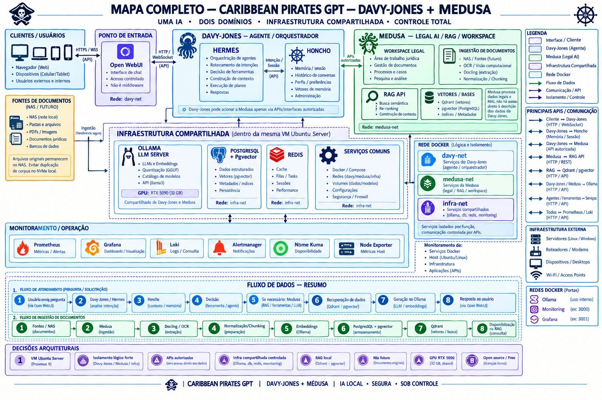

# Lab davy-jones-hermes

Lab de IA **100% local** (sem internet) para um escritório de advocacia pequeno: chat com
memória de longo prazo por usuário e **RAG jurídica com citação** — rodando num único host
com GPU de 8 GB.

- **Open WebUI** (HTTPS) para o escritório: login e-mail+senha; cada pessoa só vê a própria memória.
- **Hermes gateway** orquestra o agente; modelo `qwen3:4b-64k` no Ollama (GPU ROCm).
- **mem0** guarda fatos por usuário (`user_id` = e-mail) no **Qdrant**; a RAG usa o mesmo Qdrant
  (coleções `owui_*`, embeddings `bge-m3`, extração Docling).
- **nginx** termina o TLS na LAN; **Prometheus + Grafana** mostram o estado; **backup diário**
  com prova de restore; **CI** roda o oráculo todo dia.

> Este diretório é o **repositório de trabalho** (compartilhado por SMB). O host executa uma
> cópia sincronizada em `/home/usuario/hermes-architect` — é essa cópia que o cron usa.

## Mapa Davy-Jones + Medusa (referência)



> **Diagrama conceitual — não é o inventário operacional deste lab.** Esta é a versão atualizada
> pelo projeto [Medusa](https://github.com/landeletronic/projeto-medusa-public), no commit
> `4fbd067` de 2026-10-24. O “Davy-Jones” desenhado ali é o domínio de administração integrado
> ao Medusa; não corresponde, componente por componente, ao host deste repositório. Por exemplo,
> o mapa propõe infraestrutura compartilhada com RTX 5090, PostgreSQL/pgvector, Redis, Loki e
> Alertmanager, enquanto este lab roda os **12 containers** da tabela abaixo numa RX 6600.
> A suíte (`tests/verify_stack.sh`) continua sendo a fonte de verdade do estado real.
>
> A figura acima é 1536×1024, JPEG (625.007 bytes). A árvore sincronizada não aceita binário
> acima de 1 MiB; por isso o **PNG original de 2.017.277 bytes** fica fora do git e do host, em
> `archive/mapa-arquitetura-medusa-davy-jones.png` (cópia byte a byte, SHA-256 conferido).

## Estado atual (2026-10-23)

| Item | Estado |
|---|---|
| Containers | 12, todos `healthy` |
| Oráculo | `tests/verify_stack.sh` — **245 verificações**, CI diário 04:10 |
| Alertas | **13 regras** no grupo `lab` (Prometheus) + painel `hermes-alerts` + notificação no Windows |
| Backup | diário 03:30, retenção **14 diários + 6 mensais**, `webui.db` + `grafana.db` + snapshots, **restore provado** (inclusive em ambiente limpo) |
| TLS | autoassinado até **2029-01-20**, alerta aos 30 dias, renovação em 1 comando |
| Modelos | `qwen3:4b-64k` com KV `q4_0`: 100% na GPU e residente junto do `bge-m3` |
| Qdrant | **v1.19.2** (upgrade por degrau, provado em cópia do volume) |
| Pendente | P3 restante: citação verificável, retenção LGPD, auditoria leve, off-site real |

Backlog completo e evidências: **`docs/reports/RELATORIO-LACUNAS.md`**.

## Hardware e software instalados

Medido no host em **2026-10-23** (`lscpu`, `dmidecode`, `lsblk`, `docker ps`, `ollama list`).

### Servidor

| Item | Especificação |
|---|---|
| Máquina | VM **QEMU/KVM** com a GPU em *passthrough* (VFIO) |
| CPU | Intel Core i7-13700 — **16 vCPU** (x86_64, VT-x) |
| Memória | **16 GB** (15 GiB visíveis) |
| GPU | **AMD Radeon RX 6600** (Navi 23, 8 GB) — é ela que roda os modelos |
| Disco | 1 TB virtio sobre LVM: `/` com 1004 GB, **57 GB usados (6%)** |
| Rede | LAN `192.168.15.0/24` — 80/443 (nginx), 3001 (Grafana), 9119 (dashboard), 22 (SSH), 445 (SMB) |
| SO | **Ubuntu 26.04.1 LTS** · kernel `7.0.0-38-generic` · fuso `America/Sao_Paulo` |

> A tabela acima é a **VM** que roda o lab. O **servidor físico** que a hospeda (Proxmox) tem
> inventário próprio — placa-mãe, CPU, GPU, rede, USB 1.1/2.0/3.x e portas do painel:
> [`docs/architecture/INVENTARIO-HARDWARE-PROXMOX.md`](docs/architecture/INVENTARIO-HARDWARE-PROXMOX.md)
> (gerado por `tools/inventario-proxmox.ps1`, a partir do Windows).

### Servidor físico (Proxmox — `192.168.15.221`)

Medido pelo inventário de 2026-10-23 (DMI/SMBIOS, `lspci`, `/sys`). É o ferro que hospeda a VM.

| Item | Especificação |
|---|---|
| Placa-mãe | **ASRock B660M-HDV** — BIOS AMI **20.01** (27/11/2025), micro-ATX, socket LGA1700 |
| CPU | Intel Core i7-13700 — **16 núcleos / 24 threads** (até 5200 MHz, Raptor Lake) |
| Memória | **2 × 16 GB Kingston Fury `KF3200C16D4/16GX`** — **31 GiB** visíveis, rodando a **2400 MT/s** (kit DDR4-3200; XMP desligado no BIOS) |
| GPU | **AMD Radeon RX 6600** (ASRock, Navi 23, 8 GB) — única VGA, presa em `vfio-pci` para a VM: o ferro **não tem saída de vídeo local** |
| Rede | **Intel I219-V** (`e1000e`, `enp0s31f6`) — Gigabit |
| USB | **1 controlador xHCI** (Alder Lake-S): root hub **USB 2.0** com 16 portas e **USB 3.x** com 10 portas; nenhum controlador USB 1.1 dedicado |
| Áudio | Intel Alder Lake-S HD Audio (placa) + áudio HDMI/DP da GPU |
| SO | **Proxmox VE 9.2.21** · Debian 13 trixie · kernel `7.0.14-23-pve` · host `pve-aorus` |
| Fonte · cooler · gabinete | **não são vistos por software** — exigem ler a etiqueta dentro do gabinete (o DMI só traz `To Be Filled By O.E.M.`); o inventário diz isso em vez de inventar |

> Números de série, UUID e *asset tag* são mascarados no documento de propósito (o arquivo vai
> também para o espelho público); MAC address não é coletado.

### Software do host

| Software | Versão | Para quê |
|---|---|---|
| Docker Engine | **29.9.0** | containers |
| Docker Compose | **v5.6.0** | orquestração |
| Python | **3.14.4** | scripts de `tools/` e do host |
| Git | **2.53.0** | deploy e CI |
| Bash | **5.3.9** | suíte e scripts |
| Samba | **4.23.6** | share `documentos` (SMB na 445) |
| cron | **3.0pl1** | backup, CI, ingestão do RAG, banco de questões |
| ufw | **0.36.2** | firewall do host |
| Tesseract OCR | **5.5.0** (idioma `por`) | gabarito que só existe em imagem |
| Poppler | **26.01.0** | `pdftotext` / `pdftoppm` (inspeção de PDF) |

### Serviços (containers — versões pinadas no `docker-compose.yml`)

| Container | Versão | Papel |
|---|---|---|
| `open-webui` | **0.12.3** | chat do escritório + RAG, em HTTPS |
| `hermes-agent` | **Hermes Agent 0.21.6** (2026.9.24) | gateway OpenAI-compatible + memória |
| `hermes-dashboard` | **Hermes Agent 0.21.6** (imagem `hermes-tools`) | painel de operação `:9119` |
| `ollama` | **0.40.2** | modelos de chat e embeddings |
| `qdrant` | **1.19.2** | banco vetorial (mem0 + RAG) |
| `docling` | **docling-serve-cpu 1.37.0** | conversão de PDF/Markdown |
| `searxng` | **2026.10.17** | meta-busca (busca web desligada no chat) |
| `nginx` | **1.31.7-alpine** | TLS e proxy da LAN |
| `prometheus` | **3.15.0** | coleta e regras de alerta |
| `node-exporter` | **1.12.1** | métricas do host |
| `cadvisor` | **0.55.1** | métricas por container |
| `grafana` | **13.2.4** | dashboards (`:3001` via nginx) |

Imagens de terceiros ficam **pinadas por digest** (a suíte reprova `:latest`/`:main`).

### Modelos de IA (`ollama list`)

| Modelo | Tamanho | Uso |
|---|---|---|
| `qwen3:4b-64k` | 2,5 GB | chat principal — 100% na GPU com KV cache `q4_0` |
| `qwen3:8b-chat-16k` | 5,2 GB | chat de estudo (conexão local do Open WebUI) |
| `qwen3:8b-extract` | 5,2 GB | extração de fatos para o mem0 |
| `bge-m3` | 1,2 GB | embeddings de 1024 dimensões (mem0 + RAG) |

### Estação de trabalho (Windows, de onde rodam deploy e alertas)

| Item | Especificação |
|---|---|
| Sistema | **Windows 11 Enterprise** 10.0.26300 (64 bits) |
| CPU | AMD Ryzen 7 5700X — 8 núcleos / 16 threads |
| Memória | 24 GB |
| GPU | AMD Radeon RX 5500 XT |
| Disco | `C:` 447 GB (159 GB livres) |
| Ferramentas | PowerShell **5.1** · Git **2.55.0** · OpenSSH **9.5p2** · OpenCode **v2.1.4** |

## Uso rápido

```powershell
# suíte completa (Windows -> host, é o oráculo)
powershell -File tests\run-tests.ps1

# deploy (espelha o repo, instala cron/scripts e roda o CI)
powershell -File ops\deploy\sync-to-host.ps1
```

```bash
# no host
bash tests/verify_stack.sh                 # suíte
/usr/local/bin/hermes-ci --quiet           # o mesmo que o cron das 04:10
bash tools/drill_restore_clean.sh          # prova de restore em ambiente limpo
mem0-maintenance --dry-run                 # higiene da memória (sem apagar)
bash tools/make_tls_cert.sh --force --reload   # renovar o certificado
```

## Endereços (LAN)

| Serviço | URL |
|---|---|
| Open WebUI | `https://192.168.15.231` |
| Grafana | `https://192.168.15.231:3001` |
| Hermes API | `http://127.0.0.1:8642` **só no host / rede interna** (bloqueada na LAN) |
| Dashboard | `http://192.168.15.231:9119` |

`:80` redireciona para HTTPS; `:3000` (OWUI) e `:6333`/`:11434` (Qdrant/Ollama) ficam fora da LAN.
O certificado é autoassinado — o navegador avisa "não confiável" até você confiar nele.

## Rotinas automáticas

| Quando | O quê |
|---|---|
| 03:00 | `mem0-maintenance` — dedup/teto da memória |
| 03:20 | `tls-cert-metrics` — validade do certificado |
| 03:30 | `hermes-backup` — banco + configs + snapshots do Qdrant |
| 04:10 | `hermes-ci` — o oráculo; publica métricas e logs |
| a cada 30 min | `ops/windows/watch-alerts.ps1` (Windows, tarefa **"Hermes Lab Alerts"**) — toast/balão + `~/hermes-alerts.log` |
| 12:00 | `ops/windows/pull-backups.ps1` (Windows, tarefa **"Hermes Lab Backup Pull"**) — cópia para `\\localhost\backups` |

## Documentos

A raiz do repositório é **código e configuração**: `AGENTS.md` (regras), `README.md`,
`docker-compose.yml`, `ops/`, `tools/`, `tests/`, `monitoring/`, `nginx/`, `searxng/`,
`hermes-data/`. O conhecimento vive em `docs/`, por assunto:

| Onde | Para quê |
|---|---|
| **`AGENTS.md`** | **regras do projeto** — leia antes de mexer; invariantes, deploy e armadilhas |
| **`docs/README.md`** | índice da documentação (comece por aqui) |
| `docs/ai-memory.md` | memória consolidada: diretrizes, o que deu certo, o que deu problema |
| `docs/architecture/` | como o lab é feito e por quê (retratos do host, decisões de desenho) |
| `docs/runbooks/` | como cada fase foi construída e como operar/consertar (números são da época) |
| `docs/runbooks/TROUBLESHOOTING.md` | **algo quebrou?** triagem por sintoma — comece por aqui |
| `docs/runbooks/servicos/` | um card por container: verificar, reiniciar, falhas comuns, backup |
| `docs/runbooks/scripts/` | um card por script de `ops/` + índice dos scripts de `tools/` |
| `docs/plans/` | planos originais (mem0/RAG, trilha paralela do ChatGPT) |
| `docs/reports/` | relatórios de Estado: lacunas de endurecimento (#1–#10), relatório técnico |
| `docs/learning/` | trilha de aprendizado (N0–N5) e onde o lab está nela |
| `archive/` | **fora do git**: ebook, PDFs antigos e exports de sessão (podem conter segredo) |

## Regra de ouro

Uma mudança por vez, **oráculo antes e depois**. Bug corrigido = **check novo** em
`tests/verify_stack.sh`. Mexeu em `tests/`, compose ou configs? **Sincronize** — o cron valida
a cópia do host, não a pasta do Windows.
