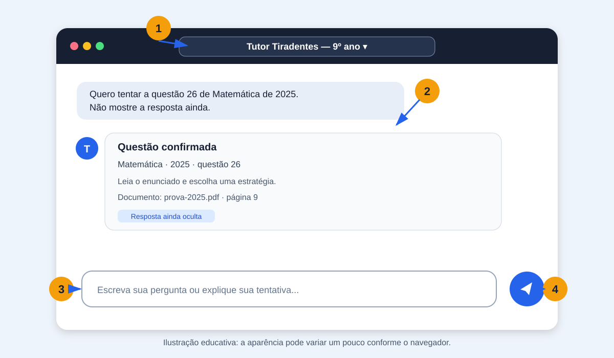
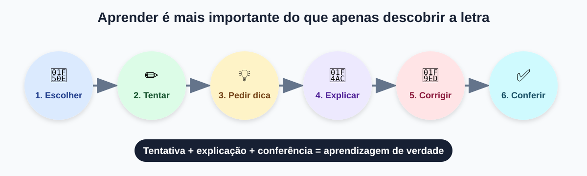

# Tutor Tiradentes — guia de uso para alunas do 9º ano

> **Objetivo:** aprender a estudar questões das provas do Colégio Tiradentes com a ajuda de um
> tutor de inteligência artificial, sem perder a oportunidade de pensar e resolver por conta própria.

## O que você vai aprender

Ao final deste tutorial, você saberá:

- abrir o **Tutor Tiradentes — 9º ano**;
- localizar uma questão pelo ano e pelo número;
- pedir uma dica sem receber a resposta;
- apresentar sua tentativa e pedir uma correção;
- conferir o documento, a página e o gabarito usados pelo tutor;
- reconhecer situações em que deve pedir ajuda a uma professora ou responsável.

## 1. Conheça a tela

Abra no navegador o endereço fornecido pela professora ou responsável e entre com seu usuário e
senha. Em seguida, comece uma conversa nova.



1. Confira se aparece **Tutor Tiradentes — 9º ano** na tela e no seletor da caixa de mensagem.
2. Clique na caixa de mensagem e escreva sua pergunta.
3. Pressione `Enter` para enviar e aguarde a resposta. A primeira resposta pode demorar um pouco
   mais.

> **Atenção:** escolha o nome completo **Tutor Tiradentes — 9º ano**. Não escolha diretamente
> `qwen3:8b-chat-16k`.

## 2. Faça sua primeira atividade

Vamos estudar sem olhar a resposta antes de tentar.

### Passo 1 — peça a questão

Escreva:

> Quero tentar a questão 26 de Matemática de 2025. Não mostre a resposta ainda.

O tutor deverá mostrar a identificação, o enunciado e as alternativas da questão.

### Passo 2 — pense antes de pedir ajuda

Leia com calma e anote no caderno:

1. O que a questão está pedindo?
2. Quais dados foram fornecidos?
3. Qual conteúdo matemático parece necessário?
4. Que operação, fórmula ou estratégia você poderia usar?

### Passo 3 — peça somente uma dica

Se não souber como começar, escreva:

> Dê apenas uma dica. Não revele a alternativa correta.

Use a dica para fazer uma nova tentativa. A dica deve ajudar você a começar, não resolver tudo.

### Passo 4 — apresente seu raciocínio

Não envie apenas uma letra. Explique como pensou:

> Eu marquei a alternativa D porque fiz primeiro ______ e depois ______. Pode corrigir meu
> raciocínio sem pular as etapas?

Assim, o tutor poderá mostrar exatamente onde seu raciocínio está correto e onde pode melhorar.

### Passo 5 — veja a resolução completa

Depois da sua tentativa, escreva:

> Agora mostre a resolução completa passo a passo.

Confira os cálculos no caderno. Não aceite a resposta somente porque foi escrita por uma IA.

## 3. O melhor caminho para aprender



O caminho recomendado é:

1. **Escolher** uma questão.
2. **Tentar** resolver sozinha.
3. Pedir **uma dica**, se necessário.
4. **Explicar** seu raciocínio.
5. Pedir a **correção**.
6. **Conferir** a fonte e o gabarito.

Errar durante esse processo faz parte da aprendizagem. O importante é descobrir por que uma ideia
funcionou ou não funcionou.

## 4. Maneiras de conversar com o tutor

### Resolver uma questão conhecida

Informe sempre **número, disciplina e ano**:

> Resolva passo a passo a questão 30 de Matemática de 2024.

> Quero tentar a questão 12 de Língua Portuguesa de 2023 sem ver a resposta.

Evite perguntas incompletas como “resolva a questão 26”, pois existem questões com esse número em
vários anos.

### Pedir níveis diferentes de ajuda

| Se você quer... | Pode escrever... |
|---|---|
| tentar sem ajuda | “Mostre a questão 28 de Matemática de 2022, mas não dê dicas nem a resposta.” |
| receber uma pista | “Dê somente uma dica para começar.” |
| entender um termo | “Explique o que significa razão nesta questão.” |
| revisar uma etapa | “Confira somente o meu cálculo da segunda etapa.” |
| receber a solução | “Agora mostre a resolução completa passo a passo.” |
| corrigir sua tentativa | “Eu respondi B por este motivo: [...]. Corrija meu raciocínio.” |

### Treinar um assunto

Você também pode tentar:

> Escolha uma questão de porcentagem para eu treinar.

Depois, dentro da mesma conversa:

> Mostre outra questão parecida.

A busca por assunto ainda é mais limitada. Se ela não encontrar uma questão, tente uma palavra mais
específica, como `porcentagem`, `desconto`, `fração`, `equação`, `área` ou `perímetro`.

### Aprender um conceito

O tutor também pode explicar matérias:

> Explique porcentagem com um exemplo simples e depois proponha um exercício para eu tentar.

> Qual é a diferença entre área e perímetro? Use um desenho feito com texto.

> Explique por que precisamos respeitar a ordem das operações.

## 5. Como conferir uma resposta

Quando o tutor resolver uma questão, verifique se a resposta apresenta:

- o **ano** e o **número** corretos;
- a **disciplina** correta;
- o enunciado e as alternativas;
- os dados retirados do enunciado;
- a estratégia e as etapas da resolução;
- a alternativa encontrada;
- a comparação com o gabarito;
- o nome do documento e a página de origem.

Exemplo do final esperado:

```text
Alternativa correta: (C) — confere com o gabarito armazenado.
Documento e página de origem: prova-2025.pdf, página 9.
```

Se o ano, o número, a página ou o documento estiverem errados, não use a resposta. Avise uma
professora ou responsável.

## 6. Continue na mesma conversa

Depois que você identifica uma questão, pode continuar com mensagens curtas:

```text
Aluna: Quero tentar a questão 26 de Matemática de 2025.
Tutor: [apresenta a questão]
Aluna: Dê apenas uma dica.
Tutor: [apresenta uma pista]
Aluna: Eu respondi D porque somei os dois valores. Corrija minha resposta.
Tutor: [corrige a tentativa]
Aluna: Agora mostre a resolução completa.
Tutor: [apresenta a resolução]
```

Para estudar outra questão sem misturar os assuntos, você pode começar uma conversa nova.

## 7. Imagens e questões com figuras

O Tutor Tiradentes atual trabalha principalmente com texto. Ele **não consegue interpretar uma foto
ou captura de tela enviada pela aluna**.

Em vez de colar uma imagem, informe os dados da questão:

> Quero estudar a questão 26 de Matemática de 2025.

Algumas provas possuem alternativas formadas por figuras ou tabelas. Se o tutor disser que faltam
informações visuais, não peça que ele adivinhe. Consulte o PDF original com uma professora ou
responsável.

## 8. Mensagens importantes

### “Não consegui localizar com segurança essa questão”

Confira se você informou:

- o número da questão;
- o ano da prova;
- a disciplina correta.

Se os dados estiverem corretos, peça ajuda a uma professora ou responsável. Não escolha uma questão
parecida como se fosse a mesma.

### “Não consegui preparar a explicação agora”

Aguarde alguns instantes e tente novamente. Se continuar acontecendo, avise o responsável pelo
laboratório.

### A resposta parece estranha ou contraditória

Pare e confira:

1. O tutor mostrou o documento e a página corretos?
2. Os números usados realmente aparecem no enunciado?
3. Os cálculos podem ser refeitos no caderno?
4. A alternativa final confere com o gabarito apresentado?

Se ainda houver dúvida, peça revisão humana.

## 9. Uso responsável da inteligência artificial

O tutor é uma ferramenta de estudo, não um substituto para seu raciocínio, sua professora ou seu
material escolar.

### Faça

- tente resolver antes de pedir a solução;
- escreva seu raciocínio;
- pergunte quando não entender uma etapa;
- confira cálculos e fontes;
- use o erro para descobrir o que precisa revisar.

### Evite

- copiar uma resposta sem compreender;
- usar o tutor para fazer uma avaliação no seu lugar;
- acreditar automaticamente em toda resposta;
- compartilhar senha ou informações pessoais;
- enviar fotos pessoais ou documentos que não fazem parte do estudo.

> **Regra de ouro:** use a IA para aprender a pensar, não para evitar pensar.

## 10. Desafio de prática

Faça esta sequência e registre as respostas no caderno:

1. Peça uma questão de porcentagem sem ver o gabarito.
2. Escreva os dados e o que a questão solicita.
3. Faça uma primeira tentativa.
4. Peça somente uma dica.
5. Revise sua tentativa.
6. Explique sua resposta ao tutor.
7. Peça a correção completa.
8. Confira documento, página e gabarito.
9. Escreva uma frase dizendo o que aprendeu com o erro ou acerto.

### Autoavaliação

Marque ao terminar:

- [ ] Informei ano, número e disciplina.
- [ ] Tentei resolver antes de pedir a resposta.
- [ ] Registrei meu raciocínio.
- [ ] Entendi por que a alternativa correta é a correta.
- [ ] Conferi o documento e a página.
- [ ] Sei qual conteúdo preciso revisar.
